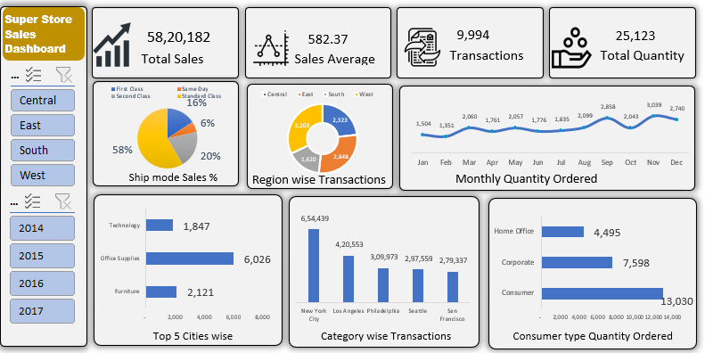

# Superstore-Data-Dashboard
An interactive Superstore Sales Dashboard built using Microsoft Excel. This project analyzes sales, profit, product categories, customer segments, regional performance, and sales trends using Pivot Tables, Pivot Charts, Slicers, and data visualization techniques to generate meaningful business insights and support data-driven decision-making.

 

Sales Avg

Total Quantity

Sales

Transactions

